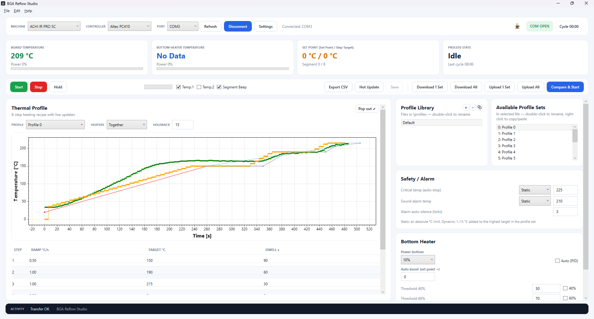

# BGA Reflow Studio

**Build, store and run thermal reflow profiles on BGA rework stations — with live temperature plotting and real controller feedback.**


-512bd4)


BGA Reflow Studio is a Windows desktop application for the **ACHI IR PRO SC**, **ACHI IR 6500** and other rework stations. It talks to the station's **Altec PC410** temperature controller over a serial link — sending profile parameters, starting and stopping cycles, and charting the board and bottom temperatures as they run.



---

## Features

- **8-step heating recipes** — ramp rate, target temperature and dwell per step, plus holdback. Ten profile sets per file.
- **Live chart & pop-out** — watch the board temperature and set point against the planned curve, or pop the chart into its own window that keeps updating.
- **Profile library** — copy / paste, duplicate, rename, CSV export, and upload / download sets to and from the controller, with **Compare &amp; Start** to reconcile differences first.
- **Static or dynamic safety limits** — set the critical-temperature auto-stop and sound alarm as an absolute °C, or as an offset above the profile's peak.
- **Bottom-heater control** — manual temperature-staged power (40 / 60 / 80 / 100 %) or an **Auto (PID)** loop that holds the bottom to set point plus boost.
- **Serial terminal** — a live view of the TX/RX hex traffic between the app and the controller, for setup and diagnosis.
- **Safety behaviours** — critical-temperature auto-stop, end-of-profile and set-point-zero auto-stop, an example-profile warning, a communication watchdog, and an optional per-segment beep.

## Supported hardware

- ACHI **IR PRO SC** and **IR 6500** rework stations, and other stations using the **Altec PC410** controller.
- A serial or USB-to-serial connection to the PC410 (default link: **9600 baud, 7 data bits, Even parity, 1 stop bit**).

## Download &amp; install

Grab the latest build from the **[Releases page](../../releases)**. Two options are provided:

| Build | Size | Needs .NET installed? |
|-------|------|-----------------------|
| **Self-contained** | ~63 MB zip | **No** — everything is bundled; unzip and run |
| **Framework-dependent** | ~7 MB zip | **Yes** — [.NET 10 Desktop Runtime](https://dotnet.microsoft.com/download/dotnet/10.0) (Windows prompts you to install it if it's missing) |

After unzipping, keep the `profiles\` and `manuals\` folders next to `BGAReflowStudio.exe`.

**Requirements:** Windows 10 or 11 (64-bit) and a serial / USB-to-serial link to the controller.

## Documentation

The full user manual ships with the app in the `manuals\` folder (`BGA Reflow Studio - User Manual.pdf`) and is also available from **Help ▸ Manuals** inside the application. The manual is generated from `manual/make_manual.py`.

## Building from source

You'll need the **.NET 10 SDK**.

```bash
git clone https://github.com/GlowElectronics/BGA-Reflow-Studio.git
cd BGA-Reflow-Studio

dotnet build BGAReflowStudio.slnx          # build
dotnet run  --project BGAReflowStudio      # run the app
dotnet test BGAReflowStudio.slnx           # run the unit tests
```

### Project structure

| Path | Purpose |
|------|---------|
| `BGAReflowStudio/` | The WPF application (UI, protocol, models) |
| `BGAReflowStudio/Protocol/` | Serial framing, command encoding and response parsing for the PC410 |
| `BGAReflowStudio/Models/` | Thermal-profile model, reflow-curve builder, PID, INI storage |
| `BGAReflowStudio.Tests/` | xUnit tests for the curve math, data model, INI storage and wire frames |
| `manual/` | The reportlab generator for the user-manual PDF |
| `BGAReflowStudio.slnx` | Visual Studio solution |

## Safety

> **Disclaimer.** This software is provided **“as is”, and you use it entirely at your own risk.** Glow Electronics accepts no responsibility or liability for any loss, injury, or damage — to equipment, components, boards, or property — arising from its use or misuse. The software commands real heaters that reach soldering temperatures; **know your machine's capabilities and safe limits before using it, and supervise every cycle.**

## Support the project

BGA Reflow Studio is **free**. If it's useful and you'd like to support future development, you can buy me a coffee:

- ☕ Ko-fi — **https://ko-fi.com/glowelectronics**

## License

Released under the [MIT License](LICENSE) — free to use, modify and distribute.

---

© Glow Electronics - 🌐 **https://glowelectronics.net/** 
